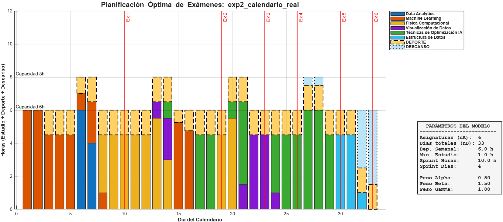
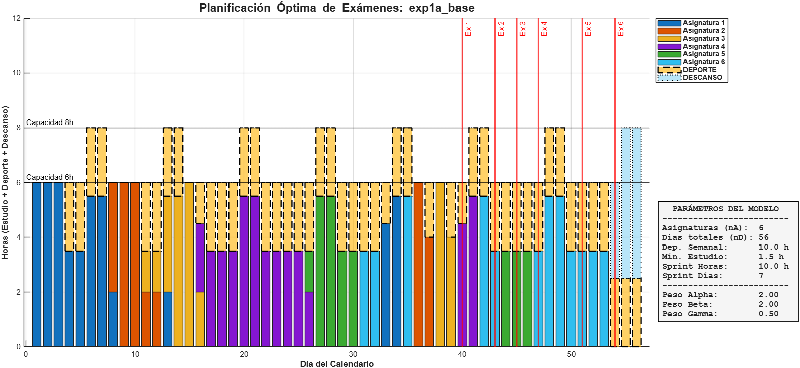
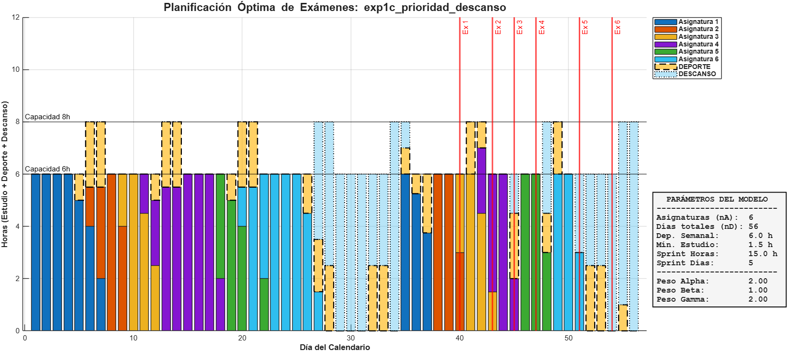

# Planificación académica y deportiva con optimización MILP

Modelo de **Programación Lineal Entera Mixta (MILP)** que genera de forma automática un calendario de estudio para varios exámenes. Reparte las horas diarias entre asignaturas, deporte y descanso para **minimizar el estrés**: penaliza estudiar a última hora y premia el ejercicio y el tiempo libre. Está implementado en **MATLAB** y se resuelve con **IBM CPLEX**.

Proyecto de *Técnicas de Optimización para IA* (Ingeniería en IA, TECNUN – Universidad de Navarra, curso 2025-26).
**Autores:** Beñat Ilzarbe Daza y Aitor Marcalain Mauleon. **Memoria completa:** [`docs/memoria.pdf`](docs/memoria.pdf)



## El problema

Es un problema de asignación de recursos: hay **tareas** (exámenes, cada uno con unas horas de estudio necesarias) y un **recurso limitado** (las horas libres de cada día). La meta no es solo llegar a todo, sino llegar de la forma más equilibrada posible.

## Formulación

**Variables de decisión** (N = 2·D·A + 3·D; 840 para 6 asignaturas y 56 días, 392 de ellas binarias):

| Variable | Significado | Tipo |
|---|---|---|
| $x_{a,d}$ | horas de estudio de la asignatura *a* el día *d* | continua |
| $y_{a,d}$ | ¿se estudia *a* el día *d*? | binaria |
| $e_d$ | horas de deporte el día *d* | continua |
| $z_d$ | ¿se hace deporte el día *d*? | binaria |
| $r_d$ | horas de descanso el día *d* | continua |

**Función objetivo:** minimizar el estrés

$$\min Z = \sum_{a}\sum_{d} W_{a,d}\,x_{a,d} \;-\; \sum_{d}\left(\beta\, e_d + \gamma\, r_d\right), \qquad W_{a,d} = 1 + \frac{\alpha}{(D_{exam,a} - d) + 1}$$

El peso $W_{a,d}$ crece a medida que se acerca el examen, así que el modelo prefiere adelantar el estudio (anti-procrastinación). $\beta$ y $\gamma$ son incentivos al deporte y al descanso.

**Restricciones**

| | Restricción |
|---|---|
| A. Carga lectiva | $\sum_{d < D_{exam,a}} x_{a,d} \ge horas_a$ |
| B. Capacidad diaria | $\sum_a x_{a,d} + e_d + r_d \le Capacidad_d$ |
| C. Bloques mínimos/máximos | $min_{est}\,y_{a,d} \le x_{a,d} \le max_{est}\,y_{a,d}$ · $min_{dep}\,z_d \le e_d \le max_{dep}\,z_d$ |
| D. Salud y rendimiento | deporte semanal ≥ meta · sprint: ≥ *sprint_horas* de estudio en los *sprint_dias* previos a cada examen |
| E. Coherencia temporal | $x_{a,d} = y_{a,d} = 0 \;\; \forall d \ge D_{exam,a}$ |

Las binarias evitan sesiones irreales de pocos minutos: o se estudia al menos 1–1,5 h o no se estudia.

## Resultados

Todos los escenarios se resuelven **hasta el óptimo en ~1 s** (CPLEX 12.10). Los resultados de [`results/`](results/) se han regenerado con el código de este repo y reproducen las figuras de la memoria.

| Escenario | Qué se prueba | Estudio | Deporte | Descanso | Objetivo |
|---|---|---|---|---|---|
| `exp1a_base` | 56 días, 6 asignaturas (3×50 h, 3×30 h). β=2, γ=0,5 | 240 h | 113,5 h | 14,5 h | 44,55 |
| `exp1b_sprint_intenso` | sprint de **15 h en 5 días** | 240 h | 113,5 h | 14,5 h | 60,05 |
| `exp1c_prioridad_descanso` | **γ=2 > β=1**, deporte semanal 6 h | 240 h | 48 h | 80 h | 78,11 |
| `exp1d_saturacion_descanso` | γ=2,5 (caso extremo) | 240 h | 40 h | 88 h | 7,31 |
| `exp2_calendario_real` | **nuestro calendario real**: 33 días (27 abr – 29 may), 6 asignaturas | 160 h | 45 h | 9 h | 96,57 |

*El valor objetivo solo es comparable entre escenarios con los mismos pesos (por ejemplo, 1a frente a 1b).*

**Qué se observa**

- **Se cumplen todas las restricciones:** cada asignatura recibe exactamente sus horas antes del examen, ninguna sesión baja del mínimo y no se estudia nada después de un examen. Los ficheros `*_resumen.txt` lo comprueban asignatura por asignatura.
- **Anti-procrastinación:** el estudio se adelanta y el sprint se queda en el mínimo exigido (10 h) para casi todas las asignaturas. Solo se supera cuando no queda otra opción, como en la última asignatura (28,5 h en su ventana).
- **Endurecer el sprint** (10 h → 15 h) mantiene la factibilidad, pero el estrés sube un **35 %** (44,6 → 60,1).
- **Deporte frente a descanso:** con β > γ el modelo llena el tiempo libre con deporte (113,5 h). Al invertir los pesos, el deporte baja justo al mínimo semanal (6 h × 8 semanas = 48 h) y el estudio se compacta para **liberar días completos de descanso**.
- **Calendario real:** con 4 exámenes entre los días 19 y 30, el modelo adelanta Data Analytics y Machine Learning a la primera semana, satura los fines de semana previos a los exámenes y deja descanso al final, una vez superado el pico.

<p align="center">
  
  
</p>

## Del modelo infactible al óptimo

La primera versión era **infactible**. Activando y desactivando restricciones con interruptores lógicos (`debug_sprint`, `debug_deporte_semanal`, `debug_min_estudio`), vimos que el conflicto venía del **mínimo semanal de deporte**: con 4 h libres entre semana y 6 h el fin de semana, la capacidad total apenas cubría las horas de estudio. Ampliar la capacidad en **+2 h/día** (6 h entre semana, 8 h el fin de semana), algo razonable en época de exámenes, hizo el problema factible. Si un escenario es infactible, el código exporta el subsistema irreducible de restricciones en conflicto (IIS) con `cplex.writeIIS`.

## Ejecutar

Requisitos: **MATLAB** e **IBM ILOG CPLEX** (gratis para uso académico, programa IBM Academic Initiative).

```matlab
cd src
main              % resuelve el calendario real (data/exp2_calendario_real.xlsx)
run_experiments   % resuelve los 5 escenarios y regenera results/
```

Si CPLEX está instalado en otra ruta, cambia el `addpath` de `main.m` y `run_experiments.m`. Se desarrolló con CPLEX 12.10 en MATLAB R2019b, y los resultados se han regenerado con CPLEX 12.10 en MATLAB R2025b.

**Crear un escenario nuevo:** copia uno de los Excel de [`data/`](data/) y edita sus tres hojas: `Asignaturas` (nombre, horas, día del examen), `Dias` (capacidad de cada día) y `Parametros` (los 10 parámetros del modelo).

## Estructura

```
├── src/
│   ├── main.m                 # punto de entrada (un escenario)
│   ├── run_experiments.m      # reproduce todos los experimentos
│   ├── resolver_escenario.m   # Excel → modelo → CPLEX → figura, CSV y resumen
│   ├── buildModel.m           # construcción del MILP (f, A, b, cotas, tipos)
│   └── Rec_Datos.m            # empaqueta los datos de entrada
├── data/                      # escenarios en Excel
├── results/                   # figura, plan diario (CSV) y resumen por escenario
└── docs/
    ├── memoria.pdf            # memoria del proyecto
    └── memoria/               # fuente LaTeX + figuras originales
```

## Tecnologías

MATLAB · IBM ILOG CPLEX · Programación Lineal Entera Mixta · LaTeX
